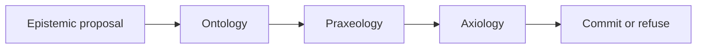

# Philip C. Asiala

I work on enterprise AI as an organizational design problem. Eligibility rules, safety interlocks, and the thresholds that authorize a transaction belong in a ledger. A model proposes. It does not commit.

**MOEPA** (Metrology, Ontology, Epistemology, Praxeology, Axiology) is the architecture for that split. The ledger stores the business logic. The runtime evaluates it. A foundation model remains an uncommitted advisor: its output is an epistemic proposal, a candidate with graded confidence, metrological metadata, evidence pointers, and an explicit unknown. The candidate is admitted only when three deterministic checks pass against one snapshot.

Ontology asks whether every referenced entity and relation is in the snapshot. Praxeology asks whether the transition is allowed from the current state. Axiology asks whether a non-compensatory constraint forbids the outcome. Confidence is not an input to the axiological check, and it never overrides a deny. A decision records the hash of the policy in force and the gate results. Every request passes through one policy-enforcing gateway; a deny is a refusal the model never sees.

## Canon

The thesis is the source of the argument. The other public repositories are the reference it cites.

| Repository | Role |
| --- | --- |
| [moepa-thesis](https://github.com/PhilipAsiala/moepa-thesis) | Working prospectus. Commitment function, chapter outline, and the claim that strategy lives in the ledger. |
| [moepa-cognitive-architecture](https://github.com/PhilipAsiala/moepa-cognitive-architecture) | Reference architecture and enterprise capability catalog. What an organization owns: data substrate, definitions, evidence, workflows, constraints, and the gateway that enforces them. |
| [moepa-profile](https://github.com/PhilipAsiala/moepa-profile) | Draft profile of JSON-LD 1.1 and RDF 1.2 for the MOEPA record: one triple plus Epistemology, Metrology, Axiology, and Praxeology envelopes. The triple stays a triple. |

`moepa-cognitive-architecture` was `philosophical-ai-architecture`; `moepa-profile` was `spop-profile`. The old names redirect. `philosophical-ai-lab` is retired.

## What the ledger holds

Apache Iceberg is the versioned, append-only record and the only system of record. The unit of storage is the MOEPA record: one triple with four envelopes — why believe it, how good it is now, what it may mean for people, what may be done with it — on the same row, as JSON-LD against a context the organization owns. A record is never updated in place; a change is a new row with the same identifier and a new fingerprint. A vector index, a graph database, and a policy engine are projections rebuilt from the ledger. A bare export of rows, without the envelopes and the policy bundle, is not the ledger.

Sovereignty, on this account, is the ability to recover that cognitive history on infrastructure the organization controls: the claims, the lineage of each admitted assertion, and the rules that governed commitment. Hosting the model is a deployment choice. The admission checks stay outside the model.

## Status

[draft/thesis.md](https://github.com/PhilipAsiala/moepa-thesis/blob/main/draft/thesis.md) is the working prospectus. Benchmarks named there are proposed. They are not reported results. The reference implementation, `moepa-lab`, runs the stack described in the architecture as one deployable unit per catalog capability, each with its own check; it is maintained apart from these three public repositories.
