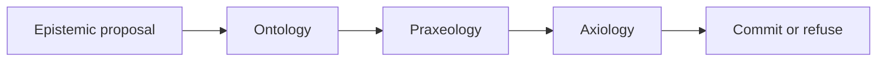

# Philip C. Asiala

I work on enterprise AI as an organizational design problem. Eligibility rules, safety interlocks, and the thresholds that authorize a transaction belong in a ledger. A model proposes. It does not commit.

**MOEPA** (Metrology, Ontology, Epistemology, Praxeology, Axiology) is the architecture for that split. The ledger stores the business logic. The runtime evaluates it. A foundation model remains an uncommitted advisor: its output is an epistemic proposal, a candidate with graded confidence, metrological metadata, evidence pointers, and an explicit unknown. The candidate is admitted only when three deterministic checks pass against one snapshot.

Ontology asks whether every referenced entity and relation is in the snapshot. Praxeology asks whether the transition is allowed from the current state. Axiology asks whether a non-compensatory constraint forbids the outcome. Confidence is not an input to the axiological check, and it never overrides a deny. A decision records the snapshot and the gate results.

## Canon

The thesis is the source of the argument. The other public repositories are the reference it cites.

| Repository | Role |
| --- | --- |
| [moepa-thesis](https://github.com/PhilipAsiala/moepa-thesis) | Working prospectus. Commitment function, chapter outline, and the claim that strategy lives in the ledger. |
| [philosophical-ai-architecture](https://github.com/PhilipAsiala/philosophical-ai-architecture) | Reference architecture. What an organization owns: data substrate, definitions, evidence, workflows, and constraints. |
| [philosophical-ai-lab](https://github.com/PhilipAsiala/philosophical-ai-lab) | Hands-on companion to the reference architecture. |
| [spop-profile](https://github.com/PhilipAsiala/spop-profile) | Draft RDF 1.2 profile. Provenance, document type, and confidence attach to the statement. |

## What the ledger holds

Apache Iceberg is the versioned, append-only record: ontological assertions as N-Quads, and the refinement rules that praxeology and axiology evaluate. A vector index, a graph database, and a policy engine are projections synced from a snapshot. They are rebuildable. A bare export of rows, without the quads and the policy bundle, is not the ledger.

Sovereignty, on this account, is the ability to recover that cognitive history on infrastructure the organization controls: the claims, the lineage of each admitted assertion, and the rules that governed commitment. Hosting the model is a deployment choice. The admission checks stay outside the model.

## Status

[draft/thesis.md](https://github.com/PhilipAsiala/moepa-thesis/blob/main/draft/thesis.md) is the working prospectus. Benchmarks named there are proposed. They are not reported results. The reference runtime that evaluates the gates is maintained apart from these four public repositories.
