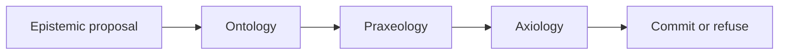

# Philip C. Asiala

Open-source researcher and architect building trusted, evidence-driven frameworks for enterprise AI. My work explores MOEPA, RDF/JSON-LD, cognitive architecture, and governance patterns for provenance, accountability, and decision integrity. Contributions are released openly for research, review, and collaboration.

**MOEPA** (Metrology, Ontology, Epistemology, Praxeology, Axiology) is the architecture for that split. The ledger stores the business logic. The runtime evaluates it. A foundation model remains an assistant, not the authority that decides whether a commitment is valid.

Ontology asks whether every referenced entity and relation is in the snapshot. Praxeology asks whether the transition is allowed from the current state. Axiology asks whether a non-compensatory consequence is acceptable given the claim being made.

## Canon

The thesis is the source of the argument. The other public repositories are the reference it cites.

| Repository | Role |
| --- | --- |
| [moepa-thesis](https://github.com/PhilipAsiala/moepa-thesis) | Working prospectus. Commitment function, chapter outline, and the claim that strategy lives in the ledger. |
| [moepa-cognitive-architecture](https://github.com/PhilipAsiala/moepa-cognitive-architecture) | Reference architecture and enterprise capability catalog. What an organization owns: data substrate, definitions, evidence, workflows, and constraints. |
| [moepa-profile](https://github.com/PhilipAsiala/moepa-profile) | Draft profile of JSON-LD 1.1 and RDF 1.2 for the MOEPA record: one triple plus Epistemology, Metrology, Axiology, and Praxeology envelopes. |

`moepa-cognitive-architecture` was `philosophical-ai-architecture`; `moepa-profile` was `spop-profile`. The old names redirect. `philosophical-ai-lab` is retired.

## What the ledger holds

Apache Iceberg is the versioned, append-only record and the only system of record. The unit of storage is the MOEPA record: one triple with four envelopes — why believe it, how good it is now, what action it authorizes, and whether it is acceptable.

Sovereignty, on this account, is the ability to recover that cognitive history on infrastructure the organization controls: the claims, the lineage of each admitted assertion, and the rules that govern admissibility.

## Status

[draft/thesis.md](https://github.com/PhilipAsiala/moepa-thesis/blob/main/draft/thesis.md) is the working prospectus. Benchmarks named there are proposed. They are not reported results. The references are public and meant for review.
