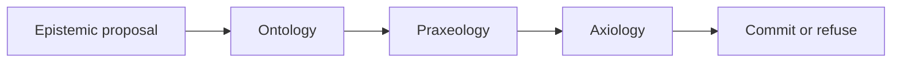

# Philip C. Asiala

I work on enterprise AI as an organizational design problem, in the open, so the argument can be reviewed while it is being made. Eligibility rules, safety interlocks, and the thresholds that authorize a transaction belong in a ledger. A model proposes. It does not commit.

**MOEPA** (Metrology, Ontology, Epistemology, Praxeology, Axiology) is the architecture for that split. The ledger stores the business logic. The runtime evaluates it. A foundation model remains an uncommitted advisor: its output is an epistemic proposal, a candidate with graded confidence, metrological metadata, evidence pointers, and an explicit unknown. The candidate is admitted only when three deterministic checks pass against one snapshot.

Ontology asks whether every referenced entity and relation is in the snapshot. Praxeology asks whether the transition is allowed from the current state. Axiology asks whether a non-compensatory constraint forbids the outcome. Confidence is not an input to the axiological check, and it never overrides a deny. A decision records the hash of the policy in force and the gate results. Every request passes through one policy-enforcing gateway; a deny is a refusal the model never sees.

## Canon

The thesis is the source of the argument. The other public repositories are the reference it cites.

| Repository | Role |
| --- | --- |
| [moepa-thesis](https://github.com/PhilipAsiala/moepa-thesis) | Working prospectus. Commitment function, chapter outline, and the claim that strategy lives in the ledger. |
| [moepa-cognitive-architecture](https://github.com/PhilipAsiala/moepa-cognitive-architecture) | Reference architecture and enterprise capability catalog. What an organization owns: data substrate, definitions, evidence, workflows, constraints, and the gateway that enforces them. |
| [moepa-profile](https://github.com/PhilipAsiala/moepa-profile) | Draft profile of JSON-LD 1.1 and RDF 1.2 for the MOEPA record: one triple plus Epistemology, Metrology, Axiology, and Praxeology envelopes. The triple stays a triple. |
| [essex-portfolio](https://github.com/PhilipAsiala/essex-portfolio) | My University of Essex portfolio: one page per module, the artefacts each produced, and a reflection on each. The thesis is written as part of that study. |

`moepa-cognitive-architecture` was `philosophical-ai-architecture`; `moepa-profile` was `spop-profile`. The old names redirect. `philosophical-ai-lab` is retired.

## What the ledger holds

Apache Iceberg is the versioned, append-only record and the only system of record. The unit of storage is the MOEPA record: one triple with four envelopes — why believe it, how good it is now, what it may mean for people, what may be done with it — on the same row, as JSON-LD against a context the organization owns. A record is never updated in place; a change is a new row with the same identifier and a new fingerprint. The definitions the checks read earn their authority by curation: raw ingest is bronze, human-enriched work is silver, and only a recorded human promotion makes a definition gold, which is all the checks ever read. A vector index, a graph database, and a policy engine are projections rebuilt from the ledger. A bare export of rows, without the envelopes and the policy bundle, is not the ledger.

Sovereignty, on this account, is the ability to recover that cognitive history on infrastructure the organization controls: the claims, the lineage of each admitted assertion, and the rules that governed commitment. Hosting the model is a deployment choice. The admission checks stay outside the model.

## Status

[draft/thesis.md](https://github.com/PhilipAsiala/moepa-thesis/blob/main/draft/thesis.md) is the working prospectus. Benchmarks named there are proposed. They are not reported results.

The reference implementation is `moepa-lab`, a private repository with one deployable unit per catalog capability, each with its own check. It runs on hardware I own with local models and rents nothing. The checks assert that a denied request never reaches the model, that the policy hash on a decision matches the bundle in force, that every projection can be emptied and rebuilt from the ledger, and that a unit can be replaced without touching the others. These are checks on one deployment, not a comparison across several, so they show what this stack does and not that the architecture is independent of its host. What the checks prove is reported back into the architecture and the thesis as what the deployment does, not as benchmark results.

## Support this work

This is one person's research, done in the open, with the infrastructure paid for out of pocket. What helps, in order of how much:

1. **Read it and argue.** Open an issue on [moepa-thesis](https://github.com/PhilipAsiala/moepa-thesis/issues) where the argument is wrong, unclear, or already made better by someone I have not cited. A disagreement with a reference is worth more than a star.
2. **Try the record.** Put one of your own assertions into the shape [moepa-profile](https://github.com/PhilipAsiala/moepa-profile) describes and tell me what the envelopes could not hold. That is how the profile gets corrected.
3. **Sponsor the infrastructure.** [GitHub Sponsors](https://github.com/sponsors/PhilipAsiala) pays for the hardware the reference stack runs on, the model tokens the checks spend, and the time to keep the stack running and its results reported back into the public canon.
4. **Cite it.** If the ledger-as-strategy argument or the five-layer record is useful in your own work, cite the prospectus by repository and commit until there is a published version.
5. **Star and watch** the canon repositories so changes to the argument reach you.

Correspondence: the address on [asiala.net](https://asiala.net).
